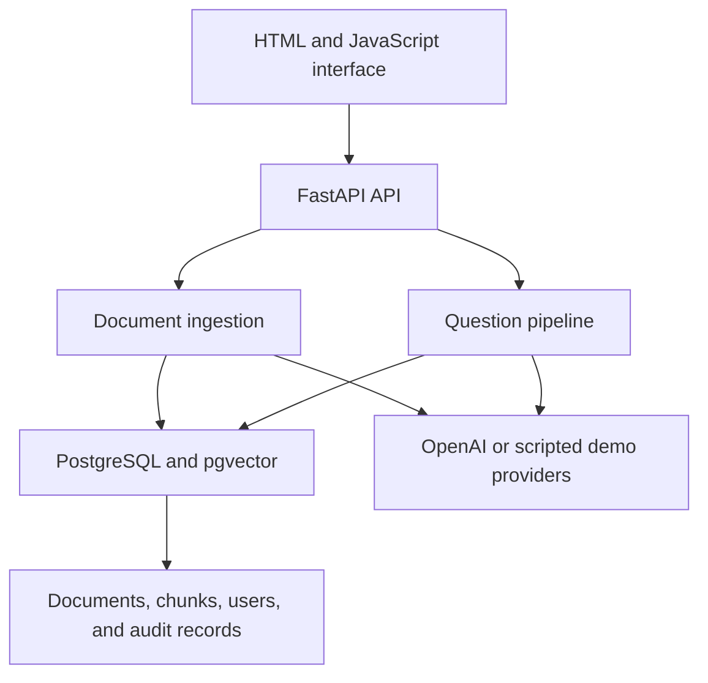
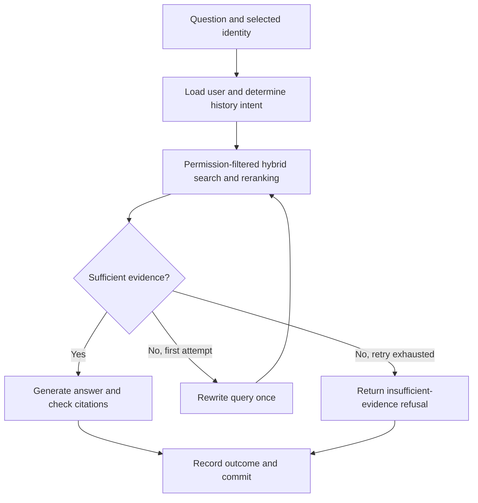

# Enterprise Document Assistant

A document question-answering application that retrieves company policy evidence, applies access and version filters, and generates answers with traceable citations.

Built with **Python, FastAPI, PostgreSQL, pgvector, OpenAI, and a plain HTML/JavaScript interface**. The project includes a separate offline demo mode for exploring the application without an OpenAI API key.

## Problem statement

Company policies are often spread across multiple documents and versions. Finding an answer requires locating the right document, checking whether it is current, and verifying that the employee is allowed to access it. A fluent AI response is insufficient if it relies on an outdated policy, reveals restricted information, or cannot identify its supporting evidence.

This project explores how retrieval-augmented generation (RAG) can help users ask policy questions in plain English while keeping document access, version selection, and source traceability explicit.

## Objectives

- Retrieve relevant policy sections using both semantic and keyword search.
- Filter restricted and ineligible policy content before it reaches model-backed processing.
- Return answers with references and supporting quotations.
- Support historical questions without silently treating superseded policies as current.
- Refuse questions when the available evidence is insufficient.
- Record completed answers and refusals for inspection.

## Current status

**Phase 1 implementation is in place; live OpenAI end-to-end validation remains pending.**

Implemented components include configuration validation, PostgreSQL storage, Markdown ingestion, hybrid retrieval, reranking, answer generation, bounded retries, audit records, FastAPI endpoints, and the browser interface.

The repository includes unit tests with fake providers and opt-in PostgreSQL integration tests. Their presence does not establish that the latest checkout has passed: run the commands below in your environment. Model-backed behavior and retrieval quality require separate live evaluation. Visual browser verification also remains pending in the documented project status.

**Authentication is simulated.** Users select a seeded identity; client-supplied usernames can be impersonated. This is a local learning and portfolio application, not a production access-control system.

## Features

| Area | Implementation |
| --- | --- |
| Document ingestion | UTF-8 Markdown uploads with validated YAML metadata |
| Chunking | Section-aware splitting with configurable character size and overlap |
| Duplicate handling | Content hashing, duplicate detection, and atomic edits of a title/version |
| Retrieval | pgvector similarity search and PostgreSQL full-text search, fused using reciprocal rank fusion (RRF) |
| Access filtering | SQL filters applied to both vector and keyword candidates |
| Reranking | Structured model scores with minimum-score filtering and a top-k limit |
| Evidence handling | Conditional evidence grading and at most one query-rewrite retry |
| Answer generation | Structured drafts, numbered references, and supporting quotations |
| Citation checks | Quote matching, reference checks, and at most one repair attempt |
| Policy versions | Current-policy eligibility and an explicit historical-query path |
| Warnings | Historical-policy, freshness, and failed-grounding warnings |
| Auditing | Records for completed answers and refusals |
| Offline demo | Scripted providers and isolated database storage; no OpenAI calls |

## Architecture

### Application components



The API coordinates uploads and questions. PostgreSQL holds structured records, full-text indexes, and vectors. OpenAI supplies live embeddings and model responses. Demo mode substitutes scripted providers and uses a separate database schema.

### Document ingestion

1. Check the selected identity, upload size, file encoding, and department ownership.
2. Parse the Markdown front matter and validate required policy metadata.
3. Normalize the upload and compute a content hash for duplicate detection.
4. Split the body into sections, then into overlapping character-based chunks.
5. Generate embeddings for the chunks.
6. Atomically store the document and chunks, or report a duplicate.

An edited title/version replaces its stored content and chunks atomically. Embedding failures leave the previous policy untouched. Uploading a new active version does **not** automatically supersede another version: publication status must be managed explicitly.

### Question answering



- Vector and keyword search apply SQL access and policy-eligibility filters before candidate selection.
- Fused candidates are reranked; low-scoring candidates are discarded.
- Strong evidence can skip an additional grading call. Otherwise, a grader evaluates whether the excerpts answer the original question.
- One query-rewrite retry is allowed when evidence is insufficient. Identity, history settings, and policy date remain unchanged.
- Generation always receives the original question. Citation checks may trigger one separate repair attempt.
- An answer that fails grounding checks after repair is returned with an explicit untrusted warning; this differs from an insufficient-evidence refusal.
- Completed answers and refusals are audited. Audit or commit failure prevents a success response.

## Technology stack

| Layer | Technology |
| --- | --- |
| Language | Python |
| API | FastAPI and Uvicorn |
| Browser interface | HTML and JavaScript in `web/index.html` |
| Database | PostgreSQL |
| Vector search | pgvector with HNSW indexing |
| Keyword search | PostgreSQL full-text search with GIN indexes and `ts_rank` |
| Candidate fusion | Reciprocal rank fusion |
| Live providers | OpenAI embeddings and structured model responses |
| Local services | Docker Compose |
| Dependency management | uv, `pyproject.toml`, and `uv.lock` |
| Tests | Python unittest and SQL smoke checks |

Keyword ranking uses PostgreSQL `ts_rank`, **not BM25**. The current implementation does not require React, ChromaDB, or SQLite.

## Repository structure

```text
assistant/
  api.py             # HTTP endpoints and application lifecycle
  config.py          # Validated configuration
  demo.py            # Scripted offline providers
  generation.py      # Structured answers and citation checks
  ingestion.py       # Markdown parsing, chunking, and indexing
  models.py          # Shared models and metadata validation
  pipeline.py        # Intent, retrieval, grading, retries, and auditing
  repository.py      # Database access and filtered search
  retrieval.py       # Query embeddings and reranking
  upload.py          # Upload handling
fixtures/
  policies/          # Fictional demonstration policies
  README.md          # Fixture scenarios
prompts/             # Answer, grade, intent, rerank, and rewrite prompts
tests/               # Unit, database integration, and SQL smoke tests
web/
  index.html         # Upload and chat interface
.env.example         # Configuration template without real secrets
docker-compose.yml   # Local PostgreSQL service
pyproject.toml       # Python project and dependency configuration
schema.sql           # Tables, indexes, and seeded demo identities
uv.lock              # Locked dependencies
```

## Prerequisites

- Git
- Python matching the project version in `.python-version` and `pyproject.toml`
- uv
- Docker Desktop running, with Docker Compose available
- An OpenAI API key with available API credits for live mode only

## Local setup

### 1. Open the project

Clone this repository using the URL shown by GitHub's **Code** button, then open its root directory in a terminal. The following commands assume that directory contains `pyproject.toml` and `docker-compose.yml`.

### 2. Install dependencies

```bash
uv sync --group dev
```

### 3. Configure the environment

If `.env` does not exist, create it from the template:

```bash
cp -n .env.example .env
```

If `.env` already exists, keep it and add any missing settings from `.env.example` manually. Never commit real API keys.

For the offline demo, set:

```dotenv
DEMO_MODE=true
```

For live OpenAI operations, set:

```dotenv
DEMO_MODE=false
OPENAI_API_KEY=your_real_key_here
```

Use `.env.example` as the configuration reference. Settings are loaded from the project `.env`, with process environment variables taking precedence. Restart the server after changing modes.

### 4. Start PostgreSQL

```bash
docker compose config --quiet
docker compose up -d --wait
docker compose ps
```

The documented local configuration uses:

| Setting | Local development value |
| --- | --- |
| Host | `localhost` |
| Port | `5434` |
| Database | `ragdb` |
| User | `rag` |
| Password | `ragsecret` |

These are local development credentials. The named `pgdata` volume preserves data between restarts. If you customize them, keep Compose and application settings consistent.

### 5. Initialize live storage

For live mode, enable pgvector and apply the database schema:

```bash
docker compose exec -T db psql -U rag -d ragdb -v ON_ERROR_STOP=1 -c "CREATE EXTENSION IF NOT EXISTS vector;"
docker compose exec -T db psql -U rag -d ragdb -v ON_ERROR_STOP=1 < schema.sql
```

The schema can be reapplied without deleting data or overwriting seeded users. Future changes to existing tables require migrations. Demo mode initializes its separate schema automatically.

### 6. Start the application

```bash
.venv/bin/python -m uvicorn assistant.api:app --reload --host 127.0.0.1 --port 8000
```

- Application: [http://127.0.0.1:8000](http://127.0.0.1:8000/)
- Interactive API documentation: [http://127.0.0.1:8000/docs](http://127.0.0.1:8000/docs)
- Health endpoint: [http://127.0.0.1:8000/health](http://127.0.0.1:8000/health)

The server binds to the local machine. PostgreSQL is required in both modes.

## Try the demo

With `DEMO_MODE=true`, confirm the interface shows a demo banner. The library starts empty: fixture files are not indexed automatically.

| Scenario | Steps | Intended behavior |
| --- | --- | --- |
| Internal policy answer | Select Bob, upload `leave_policy.md`, ask "How much annual leave?" | A cited excerpt from the uploaded policy |
| Guest restriction | Switch to Guest and ask about the internal leave policy | Restricted evidence is unavailable |
| Public policy | Select Carol and upload `refund_policy.md`; ask a refund question as Guest | Public evidence can be retrieved |
| Version handling | Upload both travel policy versions as Carol; ask about current rules and version 2 | Appropriate eligibility and historical citations |
| Missing evidence | Ask an unrelated question | Insufficient-evidence refusal |

Use files from `fixtures/policies/`; consult `fixtures/README.md` for the full scenarios. Treat this table as a walkthrough to verify, not a report of completed live validation.

### Demo mode versus live mode

| Behavior | Demo | Live |
| --- | --- | --- |
| API key | Not required | Required for model operations |
| Embeddings | Deterministic hashed word features | OpenAI embeddings |
| Reranking and grading | Word-overlap rules | Model-backed responses |
| Generation | Exact matching sentence labelled "Demo excerpt" | Model-generated structured draft |
| Database schema | `assistant_demo` | `public` |
| Purpose | Exercise application flow without API usage | Validate actual model and retrieval behavior |

Demo mode does not establish semantic retrieval quality. Synonyms, negation, nuanced questions, and comparisons may not be interpreted correctly. It still exercises metadata validation, access filtering, citation checks, retry bounds, and auditing.

After switching to live mode, restart the server and upload the sample documents again. Demo documents and fake vectors are isolated; do not copy those vectors into live storage. Live mode never silently falls back to scripted providers when a key is missing or a request fails.

## Document format and publication rules

Uploads must be UTF-8 `.md` files, up to 2 MiB, with a nonempty body and YAML front matter containing:

`title`, `department`, `visibility`, `version`, `status`, `effective`, and `updated`.

Use the fixtures as the authoritative examples of accepted values and field types. Dates use `YYYY-MM-DD`; department names are normalized to lowercase. Malformed YAML, duplicate or unsupported fields, and invalid metadata are rejected before embedding.

Splitting respects `##` sections. Text before the first section uses the policy title as its section label. The content hash includes metadata, so changing visibility changes the hash; renaming the file does not.

Normal questions exclude superseded and future-effective policies. Historical questions can include superseded policies but still exclude future-effective policies. To retire a version, reupload it with `status: superseded`. A new active version does not automatically retire another version.

## API overview

| Method | Endpoint | Purpose |
| --- | --- | --- |
| GET | `/` | Browser interface |
| GET | `/health` | Database connectivity, pgvector, and demo mode status |
| GET | `/config` | Configuration information including demo mode status |
| GET | `/documents?username=guest` | Readable document metadata for a known identity |
| POST | `/documents` | Multipart upload with `file` and `username` |
| POST | `/ask` | Question request with `question` and `username` |

Example question request after the relevant document has been uploaded:

```bash
curl -X POST http://127.0.0.1:8000/ask \
  -H 'Content-Type: application/json' \
  -d '{"question":"How much annual leave?","username":"bob"}'
```

Responses include answer text, citations, warnings, grounding errors, a processing trace, and a `fully_grounded` flag. Demo responses also identify demo mode. The flag represents implemented string/reference checks; it does not prove full semantic support.

Uploads require an employee identity whose department matches the policy. Guests cannot upload. Restricted access requires employee status and membership in the owning department. All identities remain simulated until authentication is implemented.

## Database design

| Table | Purpose |
| --- | --- |
| `users` | Seeded identities and access attributes |
| `documents` | Policy metadata, versions, and unique content hashes |
| `chunks` | Chunk text, 1536-dimensional embeddings, and generated English full-text data |
| `audit_events` | Completed answer/refusal outcomes and source labels |

The schema includes HNSW vector and GIN full-text indexes. Document title/version pairs and content hashes are unique. SQL in the repository layer enforces request-time eligibility; table definitions alone do not provide that enforcement.

## Testing

### Unit tests

Run the default suite without OpenAI or Docker:

```bash
.venv/bin/python -m unittest discover -s tests -v
```

Tests use injected fake providers. Database integration tests are opt-in.

### Database smoke checks

With PostgreSQL running and the schema applied:

```bash
docker compose exec -T db psql -U rag -d ragdb -v ON_ERROR_STOP=1 < tests/schema_smoke.sql
```

Smoke-check test data is rolled back.

### PostgreSQL integration tests

```bash
RUN_DATABASE_TESTS=1 .venv/bin/python -m unittest discover -s tests -v
```

The integration suite uses temporary test schemas and rolled-back fixtures. Coverage includes ingestion, duplicates, edits, permissions, historical retrieval, demo isolation, citations, refusals, and audit records. API and upload-to-answer tests use fake model responses.

### Live evaluation plan

With live mode configured and fixture documents reuploaded, record expected evidence, actual results, and failures for:

- Directly answerable and paraphrased questions.
- Unsupported questions and correct refusals.
- Citation quotation matching and semantic claim support.
- Guest restrictions and cross-department access attempts.
- Current and historical policy selection.
- Duplicate uploads and edited policy versions.
- Failure behavior and transaction consistency.

No live accuracy, latency, or cost benchmark is claimed yet.

## Limitations and next improvements

- **Real authentication:** replace client-controlled usernames with identity from a trusted session or token.
- **Live validation:** verify provider integration and run a representative evaluation set.
- **Grounding:** current quote/reference checks do not prove semantic support, complete claim coverage, or absence of prompt injection.
- **Formats:** Phase 1 accepts Markdown policies; PDF and DOCX support are future extensions.
- **Publication workflow:** superseding an older policy requires an explicit metadata update.
- **Failure auditing:** provider/validation failures do not currently create completed-answer audit rows; error-request auditing is not implemented.
- **Operations:** deployment hardening, migrations, monitoring, and broader performance testing remain future work.

## Stop the local database

```bash
docker compose down
```

This stops the service while retaining data in the named volume.

## Project purpose

This is a learning and portfolio project focused on building inspectable RAG application behavior: ingestion, filtered retrieval, evidence handling, citations, and failure paths. It uses fictional sample policies and makes its validation limits explicit.
